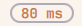

# Ping

An Omarchy shell widget: the round trip to one host, inside a soft outline on
the bar. Hover over it to watch a continuous ping; click it to get a terminal
on that ping, where you can stop it or type another command.



| Face     | Meaning                                    |
|----------|--------------------------------------------|
| `23 ms`  | the latest round trip, in the bar's colour |
| `73 ms`  | orange from 50 ms                          |
| `142 ms` | red from 100 ms                            |
| `5.6 s`  | a slow reply is shown as it is, in red     |
| `no net` | no reply for 10 s, in red                  |
| `…`      | no reply yet                               |

The outline, in the bar's text colour at half strength, marks what belongs to
the widget; its width never changes, so the widgets next to it never move.
The colours (`Attention.qml`, `Attention.js`): the theme's own orange when it
has a real one, a standard orange otherwise, always a standard red, either one
darkened or lightened just enough to read at 3:1 against the bar.

- **Hover**: a view under the face shows a shell running
  `ping <host> -i 1`, updated twice a second.
- **Click**: a terminal opens in the same place, attached to that shell.
  Ctrl+C stops the ping; Up brings the command back to change it; any other
  command works too. The terminal closes when it loses the focus, or on a
  second click, and the shell goes on running.

## How it works

Two pings run all the time, one a second each:

- The face's own, `ping -n -O -i 1 -- <host>`, read line by line
  (`Latency.js`). A late reply still counts, so a slow link shows its round
  trip rather than "no net"; "no net" means nothing came back for 10 s. If
  ping ends (no name resolution, no network), it starts again 2 s later.
- The session's, typed at your own prompt in a tmux session on a server of
  its own, `coniglio-ping`, apart from your tmux (`ping-session.sh`,
  `tmux.conf`). The shell reads `~/.bashrc`, then the command is typed in by
  readline, so it looks and behaves as if typed by hand: it is a real history
  entry, and Ctrl+C leaves you at a real prompt. The face keeps measuring
  whatever you do there.

The hover view is `tmux capture-pane`, read every 0.5 s while it shows. A
click opens `tmux attach` in the default terminal (`omarchy-launch-tui`), as a
floating window placed where the view was. Hyprland's events tell the widget
when that window opens, gets the focus and loses it; it is closed then, which
only detaches it. From anywhere: `tmux -L coniglio-ping attach -t ping`.

What it costs, measured on Omarchy 4 (Hyprland 0.56, Ghostty): about 6 MB of
memory for the tmux server, the shell and the two pings together (PSS), and no
measurable CPU. A click starts a terminal: about 0.5 s of CPU and up to
130 MB while it is open, all freed when it closes.

## Settings

The widget's entry in `~/.config/omarchy/shell.json`:

```json
{ "id": "coniglio.ping", "host": "www.google.it" }
```

`host` is a hostname or an address; `www.google.it` when absent. After a
change, `tmux -L coniglio-ping kill-server` restarts the session on the new
host.

## Install

```bash
git clone https://github.com/stefanoconiglio/omarchy-ping.git ~/repos/omarchy-ping
ln -s ~/repos/omarchy-ping ~/.config/omarchy/plugins/coniglio.ping
omarchy plugin enable coniglio.ping right
```

Needs `ping` (iputils), `tmux`, and bash as the shell of the session.

## Files

| File               | Purpose                                                       |
|--------------------|---------------------------------------------------------------|
| `manifest.json`    | Omarchy plugin manifest for `coniglio.ping`                   |
| `Ping.qml`         | The face, its ping, the hover view, the attached terminal     |
| `Latency.js`       | Reply lines, state and label; `node Latency.test.js` tests it |
| `ping-session.sh`  | Starts the session; opens a terminal attached to it           |
| `tmux.conf`        | The session's tmux server: no status line, mouse scrolling    |
| `Attention.qml/js` | The face's colours, readable on every theme's bar             |

## License

MIT, see [LICENSE](LICENSE).
